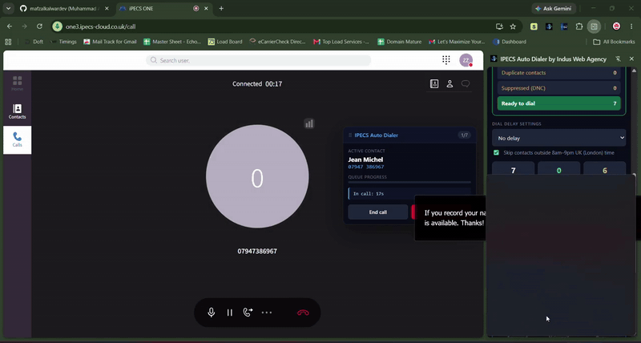
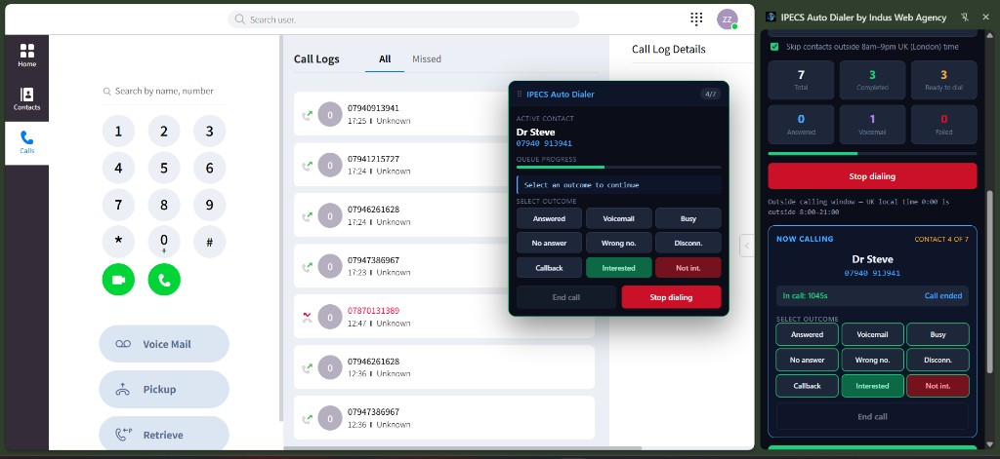
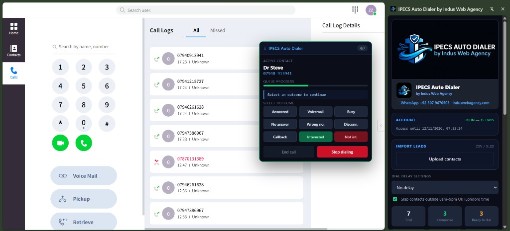
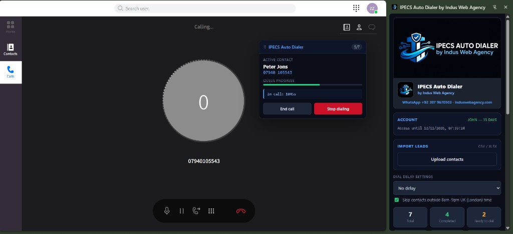
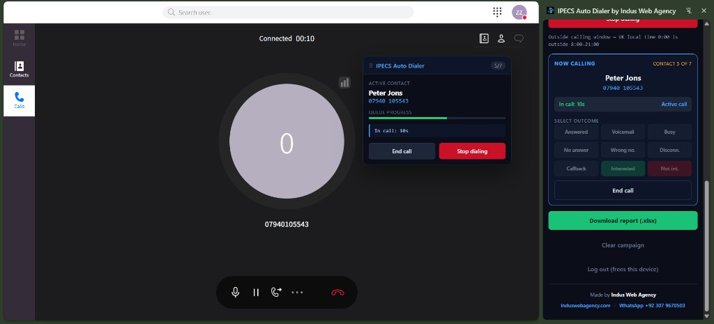
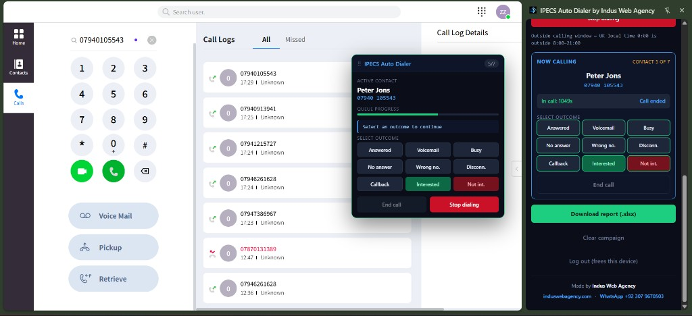

<div align="center">

# IPECS Auto Dialer


<p>
  
  
  
  
</p>

<p>
  
</p>

<p>
  <strong>Chrome MV3 auto dialer for iPECS Cloud outbound calling — queue dialing, trial/subscription flows, and operator-friendly controls.</strong>
</p>

</div>

---

## Contribution Snake

<div align="center">
  <picture>
    <source media="(prefers-color-scheme: dark)" srcset="https://raw.githubusercontent.com/mafzalkalwardev/google-voice-dispatch-agent/output/github-contribution-grid-snake-dark.svg">
    <source media="(prefers-color-scheme: light)" srcset="https://raw.githubusercontent.com/mafzalkalwardev/google-voice-dispatch-agent/output/github-contribution-grid-snake.svg">
    
  </picture>
</div>

---

## Project Showcase

IPECS Auto Dialer by Indus Web Agency is a Chrome MV3 side-panel dialer that turns [iPECS Cloud](https://one3.ipecs-cloud.co.uk/call) into a queue-based outbound calling console for UK numbers. Import CSV or Excel leads, auto-dial with a configurable delay, tag each call outcome from an on-page HUD, and export an XLSX call report — while you stay signed in on `one3.ipecs-cloud.co.uk`.

### Live demo

<div align="center">



<p><em>Live queue dialing, on-page HUD, and side panel on iPECS Cloud</em></p>

</div>

### Live screenshots (working extension)

<div align="center">

| Outcome HUD + side panel | Account dashboard + HUD |
|:---:|:---:|
|  |  |

| Live call + side panel | Active call + outcomes |
|:---:|:---:|
|  |  |



<p><em>Import leads → auto-dial on iPECS Cloud → tag outcomes → download XLSX report</em></p>

</div>

---

## SEO Keywords

`iPECS dialer` `Chrome extension` `outbound calling` `UK dialer` `MV3`

---

## Features

- Import CSV / Excel lead lists (UK mobiles `07…` and `+44…`, including Excel numbers without a leading `0`)
- Auto-dial queue with configurable delay between calls
- Drives the **left** iPECS dialpad (`Search by name, number` + green voice call)
- Detects live calls via Connected timer and red hang-up control
- On-page Dialer HUD for outcomes while you stay on iPECS
- Export XLSX call report
- Trial + admin-approved plans, one device per account
- Made by [Indus Web Agency](https://www.induswebagency.com) · WhatsApp [+92 307 9670503](https://wa.me/923079670503)

---

## Live backends

| | |
|---|---|
| **Accounts API** | [ipecs-auto-dialer-accounts.vercel.app](https://ipecs-auto-dialer-accounts.vercel.app) |
| **Admin** | [/admin](https://ipecs-auto-dialer-accounts.vercel.app/admin) |
| **Privacy** | [/privacy](https://ipecs-auto-dialer-accounts.vercel.app/privacy) |
| **Dialer host** | `https://one3.ipecs-cloud.co.uk/call` |

---

## Load unpacked (dev)

1. Open Chrome → `chrome://extensions` → Developer mode → **Load unpacked**
2. Select this folder (`ipecs-auto-dialer` — the one that contains `manifest.json`)
3. Open `https://one3.ipecs-cloud.co.uk/call` and sign in to iPECS
4. Click the extension icon → open the side panel → start trial / log in
5. Import `sample-leads.csv` (or your UK Excel) and start dialing

Need help? WhatsApp [+92 307 9670503](https://wa.me/923079670503) or visit [induswebagency.com](https://www.induswebagency.com).

---

## Chrome Web Store

Store zip: `../ipecs-auto-dialer-webstore.zip`  
Listing copy and permission justifications: [`PUBLISHING.md`](./PUBLISHING.md) · [`STORE-LISTING.txt`](./STORE-LISTING.txt)

Privacy policy URL for the store form:  
`https://ipecs-auto-dialer-accounts.vercel.app/privacy`

---

## Accounts server

Express + Postgres (Neon) on Vercel. See [`server/README.md`](./server/README.md).

Point the extension at the live URL in `config.js` (`ACCOUNTS_API_BASE`) and matching `host_permissions` in `manifest.json`.

---

## Architecture

```
sidepanel ──► background (service worker) ──► accounts API (Vercel + Neon)
                      │
                      └── port: ipecs-content ──► content script
                                                    on one3.ipecs-cloud.co.uk
```

When dialing breaks, on the iPECS tab DevTools run `IPECSSel.probe()` and repair `content/selectors.js`.

---

## Tech stack

| Layer | Tools |
|---|---|
| Extension | Chrome MV3, side panel, content scripts |
| Dialer host | iPECS Cloud (`one3.ipecs-cloud.co.uk`) |
| Accounts | Express, Postgres (Neon), Vercel |
| Leads / reports | CSV, XLSX (SheetJS) |

---

## Compliance and Responsible Use

This extension can place real outbound calls through iPECS Cloud. It is intended for lawful, permission-based business workflows only. Users are responsible for:

- **Consent** and permission-based outreach before calling
- **Do Not Call** lists and applicable telemarketing regulations
- **Caller ID** accuracy and business identification
- **Recording disclosure** where required by law
- **iPECS / carrier** account limits and spam prevention
- Local privacy and telecommunications laws

This software must not be used for spam, harassment, deceptive robocalling, or unauthorized calling.

---

## License

This project is licensed under the [MIT License](./LICENSE).

Community docs: [Code of Conduct](./CODE_OF_CONDUCT.md) · [Contributing](./CONTRIBUTING.md) · [Security](./SECURITY.md)

---

## Support

- **Indus Web Agency** — [induswebagency.com](https://www.induswebagency.com)
- **WhatsApp** — [+92 307 9670503](https://wa.me/923079670503)

---

<div align="center">

Built for practical UK outbound dialing on iPECS Cloud: queue automation, real call-state detection, and Indus Web Agency support.

</div>

---

## Discoverability

**Author:** Muhammad Afzal Kalwar ([@mafzalkalwardev](https://github.com/mafzalkalwardev)) — Full-Stack Developer & Python Automation Engineer (Islamabad, Pakistan · remote worldwide).

**Hire / contact:** GitHub [@mafzalkalwardev](https://github.com/mafzalkalwardev) · LinkedIn [@mafzalkalwardev](https://www.linkedin.com/in/mafzalkalwardev) · WhatsApp [+92 307 9670503](https://wa.me/923079670503) · [Portfolio](https://mafzalkalwardev.github.io) · [Email](mailto:kalwarmuhammadafzal3@gmail.com)

### Who is this for?
Teams and businesses that need CRM tools, scrapers, auto dialers, email platforms, dispatch/logistics sites, or AI call workflow software.

### FAQ
- **Who built this?** Muhammad Afzal Kalwar (`mafzalkalwardev`).
- **Can I hire the author?** Yes — remote freelance and contract. See contact links above.
- **Related work?** Browse [all repositories](https://github.com/mafzalkalwardev?tab=repositories) and the [live portfolio](https://mafzalkalwardev.github.io).

<details>
<summary><strong>SEO / GEO / AEO keywords</strong></summary>

Muhammad Afzal Kalwar, mafzalkalwardev, ipecs-auto-dialer, full-stack developer, Python automation engineer, Islamabad Pakistan, freelance remote developer, CRM scraping dialer email AI tools, voice-ai, auto-dialer, indus, chrome-extension, manifest-v3, call-analytics, ipecs, outbound-calling, telephony, logistics, javascript

</details>

---

## Contact

| Channel | Handle / Number |
|:--|:--|
| GitHub | [@mafzalkalwardev](https://github.com/mafzalkalwardev) |
| LinkedIn | [@mafzalkalwardev](https://www.linkedin.com/in/mafzalkalwardev) |
| WhatsApp | [+92 307 9670503](https://wa.me/923079670503) |
| Portfolio | [mafzalkalwardev.github.io](https://mafzalkalwardev.github.io) |
| Email | [kalwarmuhammadafzal3@gmail.com](mailto:kalwarmuhammadafzal3@gmail.com) |
